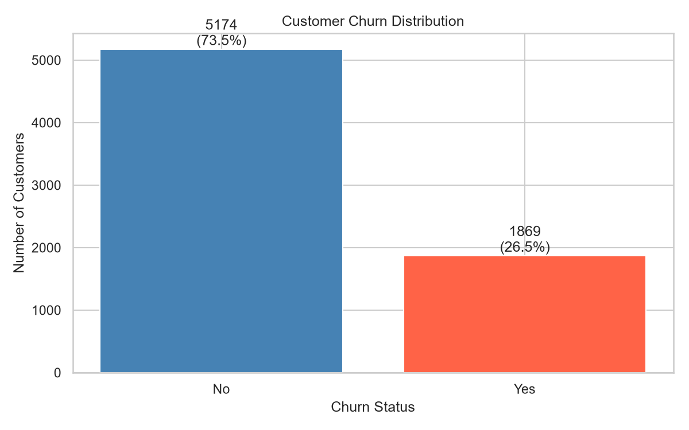
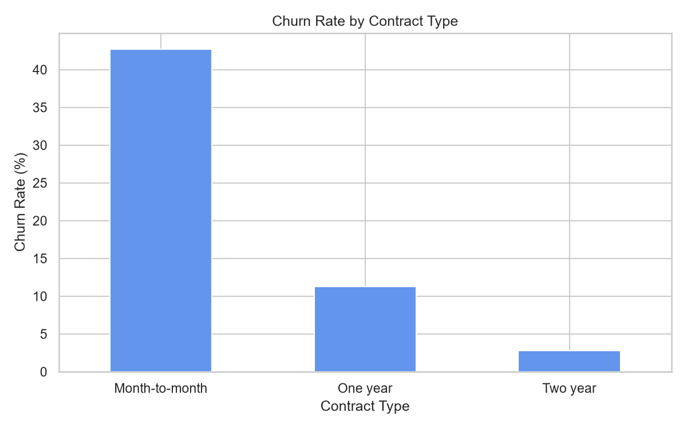
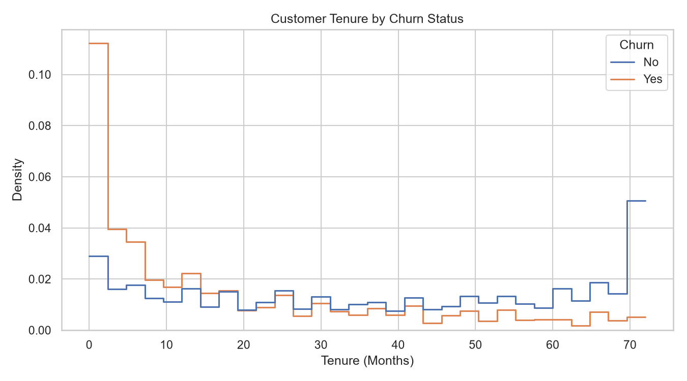
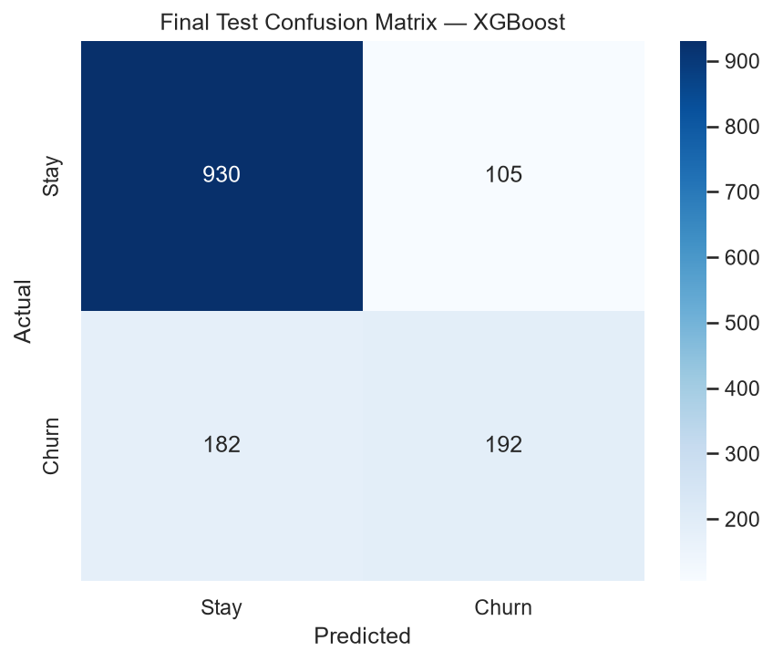
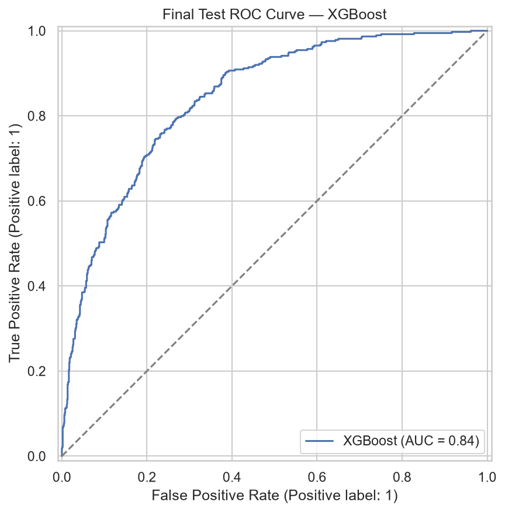

# 📊 Customer Churn Prediction

An end-to-end Machine Learning application that estimates whether a telecom customer may leave a service. The project combines customer data analysis, a trained **XGBoost** model, and an interactive **Streamlit** dashboard to explore churn probability and support customer-retention review.

<p align="center">
  <a href="https://customer-churn-prediction-2sxm7njlqimhetnjkumozs.streamlit.app/">
    
  </a>
  <a href="https://github.com/rat7050/customer-churn-prediction">
    
  </a>
</p>

<p align="center">
  
  
  
  
</p>

---

## 🚀 Live Demo

Try the deployed application without installing anything:

**[Open Customer Churn Prediction App](https://customer-churn-prediction-2sxm7njlqimhetnjkumozs.streamlit.app/)**

The app lets you enter customer service, contract, and billing details, submit a prediction, and review the estimated churn probability, risk category, and threshold-based decision.

---

## 📸 Screenshots & Visuals

### Exploratory Data Analysis — Churn Distribution



### Churn by Contract Type



### Churn and Customer Tenure



> **Want to show the live app UI here too?** Capture a screenshot of the deployed Streamlit page, upload it to this repository (for example, `assets/customer-churn-app.png`), and add:
>
> ``

---

## 🎯 Problem Statement

Customer churn occurs when customers stop using a company's product or service. Identifying customers who may be at risk can help a business prioritize customer reviews and retention efforts.

This project uses customer profile, service, contract, and billing information to estimate churn probability. The output is intended to support analysis and review—not to guarantee what a customer will do.

## ✨ Key Features

- **Individual churn prediction** using a saved ML pipeline.
- **Estimated churn probability** displayed as a percentage.
- **Risk category** (Low, Medium, or High) based on the app's probability bands.
- **Adjustable alert threshold** to change when a customer is flagged for review.
- **Customer snapshot** showing key contract, tenure, internet, and billing details.
- **Interactive probability gauge** built with Plotly.
- **Retention-review guidance** based on the prediction result.
- **Data analysis artifacts** and model evaluation reports included in the repository.

## 🧠 How It Works

```text
IBM Telco Customer Churn Dataset
              │
              ▼
     Data Understanding & EDA
              │
              ▼
     Data Cleaning / Preparation
              │
              ▼
      Model Training & Evaluation
              │
              ▼
     Saved XGBoost Pipeline
              │
              ▼
       Streamlit Web App
              │
              ▼
   Customer details entered by user
              │
              ▼
      Estimated churn probability
              │
              ▼
   Risk band + threshold-based review
```

## 📊 Dataset

This project uses the **IBM Telco Customer Churn** dataset located at `data/Telco-Customer-Churn.csv`.

The application uses customer information such as:

- **Customer profile:** gender, senior-citizen status, partner, and dependents
- **Account:** tenure, contract type, and paperless billing
- **Services:** phone, internet, security, backup, device protection, support, and streaming
- **Billing:** monthly charges and total charges

The target variable is `Churn`, mapped as:

| Target | Meaning |
|---|---|
| `No` / `0` | Customer did not churn |
| `Yes` / `1` | Customer churned |

## 🤖 Model & Evaluation

The saved model metadata identifies **XGBoost** as the selected model. The persisted pipeline is stored at `models/churn_pipeline.joblib` and loaded by the Streamlit application.

The repository's saved test metrics are:

| Metric | Test score |
|---|---:|
| Accuracy | 79.63% |
| Precision | 64.65% |
| Recall | 51.34% |
| F1 score | 57.23% |
| ROC-AUC | 84.20% |

These scores reflect the saved evaluation for this dataset and test split; they do not guarantee the same performance on new customer populations.

### Evaluation visuals

**Confusion matrix**



**ROC curve**



## 🛠️ Tech Stack

| Tool | Role |
|---|---|
| Python | Main programming language |
| Pandas | Data handling and preparation |
| NumPy | Numerical operations |
| Scikit-learn | ML utilities and evaluation |
| XGBoost | Churn classification model |
| Joblib | Saving and loading the trained pipeline |
| Streamlit | Interactive web application |
| Plotly | Prediction probability gauge |
| Jupyter Notebook | Data understanding and analysis |

## 📁 Project Structure

```text
customer-churn-prediction/
├── app.py
├── data/
│   └── Telco-Customer-Churn.csv
├── models/
│   ├── churn_pipeline.joblib
│   └── metadata.json
├── notebooks/
│   └── 01_data_understanding.ipynb
├── reports/
│   ├── figures/
│   │   ├── 01_churn_distribution.png
│   │   ├── 02_churn_by_contract.png
│   │   ├── 03_tenure_distribution.png
│   │   ├── 08_validation_confusion_matrices.png
│   │   ├── 09_validation_roc_curves.png
│   │   ├── 10_final_test_confusion_matrix.png
│   │   └── 11_final_test_roc_curve.png
│   ├── final_test_metrics.csv
│   ├── validation_model_comparison.csv
│   └── data quality and churn summary reports
└── requirements.txt
```

## 💻 Run Locally

### 1. Clone the repository

```bash
git clone https://github.com/rat7050/customer-churn-prediction.git
cd customer-churn-prediction
```

### 2. Create and activate a virtual environment

**Windows (PowerShell):**

```powershell
python -m venv .venv
.venv\Scripts\Activate.ps1
```

**macOS / Linux:**

```bash
python3 -m venv .venv
source .venv/bin/activate
```

### 3. Install dependencies

```bash
python -m pip install -r requirements.txt
```

### 4. Start the application

From the repository root, run:

```bash
streamlit run app.py
```

Open the local URL printed in your terminal (usually `http://localhost:8501`).

> The repository already contains a saved model pipeline and metadata file. The app expects them at `models/churn_pipeline.joblib` and `models/metadata.json`.

## 🧭 Using the App

1. Open the **Customer Prediction** tab.
2. Enter the customer's profile, service, contract, and billing details.
3. Adjust the churn alert threshold in the sidebar if needed.
4. Click **Predict customer churn**.
5. Review the estimated probability, risk category, and decision.
6. Use the result to prioritize further review—not as an automatic decision about a customer.

## ⚠️ Limitations & Responsible Use

- A prediction is an estimate, not a guarantee.
- Model results depend on the dataset and may not generalize to every business or customer population.
- The Low / Medium / High risk bands are illustrative.
- The alert threshold should be selected based on validation and the relative costs of false positives and false negatives.
- Use predictions as one input for human review, not as the sole basis for consequential customer decisions.

## 🔮 Future Improvements

- Add explainability with SHAP or feature-level insights.
- Add batch prediction for multiple customers.
- Include model monitoring and drift checks.
- Tune the alert threshold against business retention costs.
- Add automated tests and a CI workflow.
- Add a dedicated screenshot of the complete deployed app UI.

## 👨‍💻 Author

**Ratnesh Kumar**  
B.Tech — Artificial Intelligence & Data Science

- **GitHub:** [@rat7050](https://github.com/rat7050)
- **Repository:** [customer-churn-prediction](https://github.com/rat7050/customer-churn-prediction)
- **Live Demo:** [Customer Churn Prediction on Streamlit](https://customer-churn-prediction-2sxm7njlqimhetnjkumozs.streamlit.app/)

---

If you find this project useful, feel free to ⭐ the repository.

<p align="center"><b>Built with Python, XGBoost, and Streamlit.</b></p>
